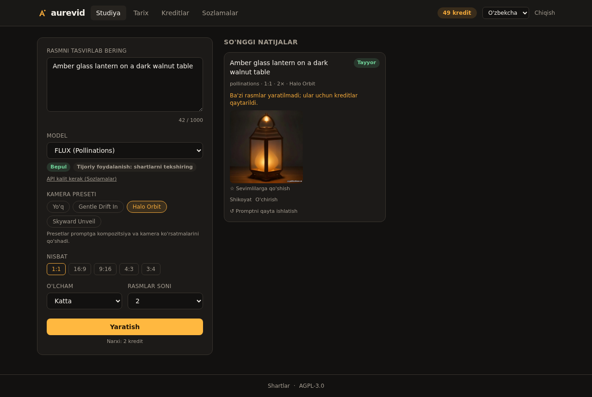

# Aurevid

**Open-source multi-model AI image studio: one prompt box, free providers first, your own keys optional.**

[O'zbekcha](README.uz.md) · [Spec](SPEC.md) · [Security](SECURITY.md) · [Threat model](docs/threat-model.md) · [Deploy](docs/deploy.md)

Aurevid lets small businesses and creators generate images from a single prompt box, pick a model
from several providers (each clearly labelled free or paid, with its commercial-use status), apply
original camera presets, and keep results in a history gallery with favourites. Interface: English,
Uzbek, Russian.



> Status: **MVP / beta.** Image generation works end to end. Video, the marketing helper, payments and
> other clients are planned, and the API is shaped for them.

## Features

- Prompt studio: model picker, aspect ratio (1:1, 16:9, 9:16, 4:3, 3:4), size, 1-4 images
- 3 original camera presets (Gentle Drift In, Halo Orbit, Skyward Unveil), stored as JSON templates
- Async job queue (works on SQLite, no Redis needed) with live status over Server-Sent Events
- History, favourites, delete, report
- Credits: append-only ledger, starter credits, daily limits, automatic refunds on failure
- Bring-your-own-key: encrypted server-side, never sent back to the browser
- Data export and account deletion
- en / uz / ru interface

## Providers

| Provider | Free? | Needs | Enabled by default |
|---|---|---|---|
| Cloudflare Workers AI (FLUX.1 schnell, Apache-2.0) | Yes, daily free allocation | Cloudflare account ID + API token (server-wide or per user) | Yes |
| fal.ai (FLUX.1 schnell) | **Paid** (user's own key) | fal.ai key | No |
| Pollinations | Yes, anonymous | nothing | **No**: its terms could not be verified, see [MODEL_LICENSES.md](MODEL_LICENSES.md) |
| Offline demo | Yes | nothing | Dev only |

## Quick start (Docker, one command)

```bash
git clone https://github.com/goldendevuz/aurevid.git && cd aurevid
docker compose up --build
```

Open http://localhost:8080 and sign up. Without a `.env` file it runs in **dev mode** with the offline
demo provider. To generate real images, create a free Cloudflare account, make an API token with
*Workers AI: Read* permission, then:

```bash
cp .env.example .env
# set CF_ACCOUNT_ID, CF_API_TOKEN, JWT_SECRET, BYOK_ENCRYPTION_KEY
docker compose up --build
```

> If Docker says *"all predefined address pools have been fully subnetted"*, you have too many old
> Docker networks: `docker network prune` removes unused ones (check the list first).

## Local development

Requirements: Python 3.12 + [uv](https://docs.astral.sh/uv/), Node 20.19+ (or 22).

```bash
cd backend
uv sync
cp ../.env.example .env        # dev values are fine; set MOCK_PROVIDER_ENABLED=true
uv run alembic upgrade head
uv run uvicorn app.main:app --reload --port 8000
```

```bash
cd frontend
npm ci
npm run dev                    # http://localhost:5173, proxies /api to :8000
```

Tests and checks:

```bash
cd backend && uv run ruff check . && uv run pytest -q
cd frontend && npm run typecheck && npm test && npm run build
```

## Architecture

```
Browser (React SPA) ──same origin──▶ nginx ──/api──▶ FastAPI ──▶ SQLite / PostgreSQL
                                                  │             ▲
                                                  ▼             │ claim job (conditional UPDATE)
                                               Redis        Worker ──▶ provider adapters
                                           (rate limits)        │      (Cloudflare, fal, ...)
                                                                ▼
                                                     asset store (disk / R2)
```

- `backend/app/providers/base.py`: the one interface every provider implements.
- `backend/app/worker.py`: DB-backed queue. Run it in the API process (`RUN_WORKER_IN_API=true`)
  for single-container hosting, or as a separate process.
- All clients (web now; Telegram bot, desktop, PWA later) use the same `/api`.

More: [docs/architecture.md](docs/architecture.md).

## Configuration

All settings are environment variables; see [.env.example](.env.example). Secrets live only in the
server environment. With `APP_ENV=prod` the app refuses to start without strong secrets, with
wildcard CORS, with insecure cookies, or with the demo provider on.

## Licence

[AGPL-3.0-or-later](LICENSE). If you run a modified version as a network service, you must offer
its source to your users; set `VITE_SOURCE_URL` so the footer links to it. Third-party licences:
[THIRD_PARTY_LICENSES.md](THIRD_PARTY_LICENSES.md); model licences: [MODEL_LICENSES.md](MODEL_LICENSES.md).

Contributions welcome: [CONTRIBUTING.md](CONTRIBUTING.md).
